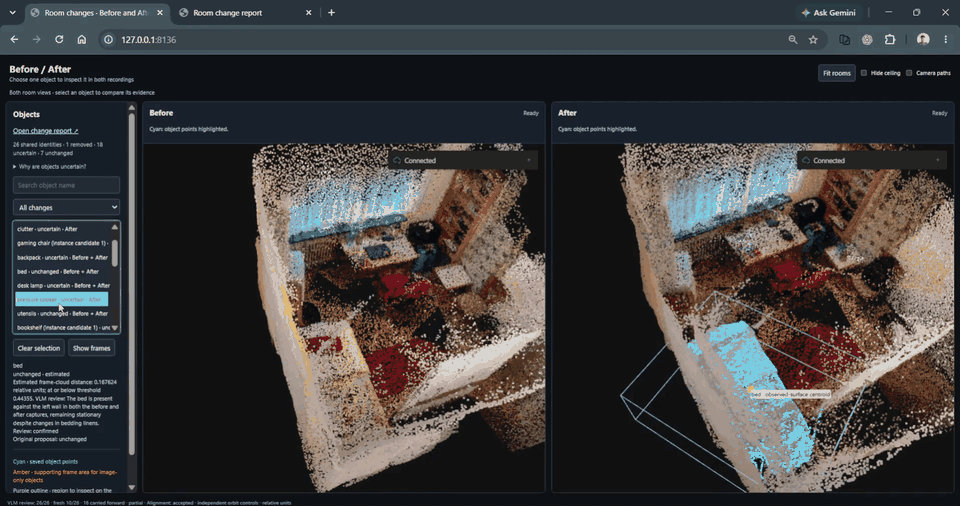
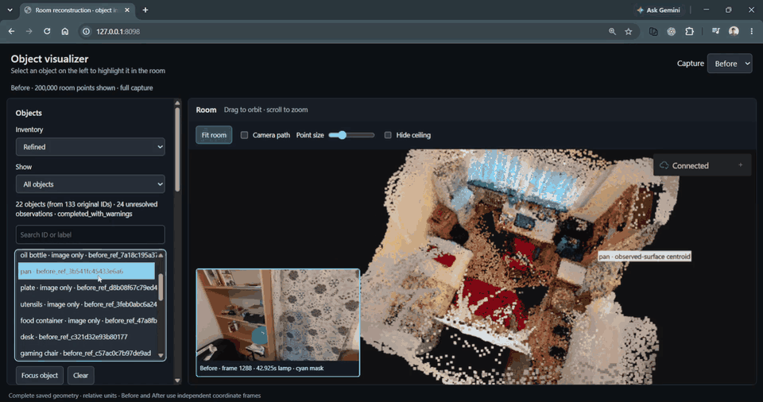
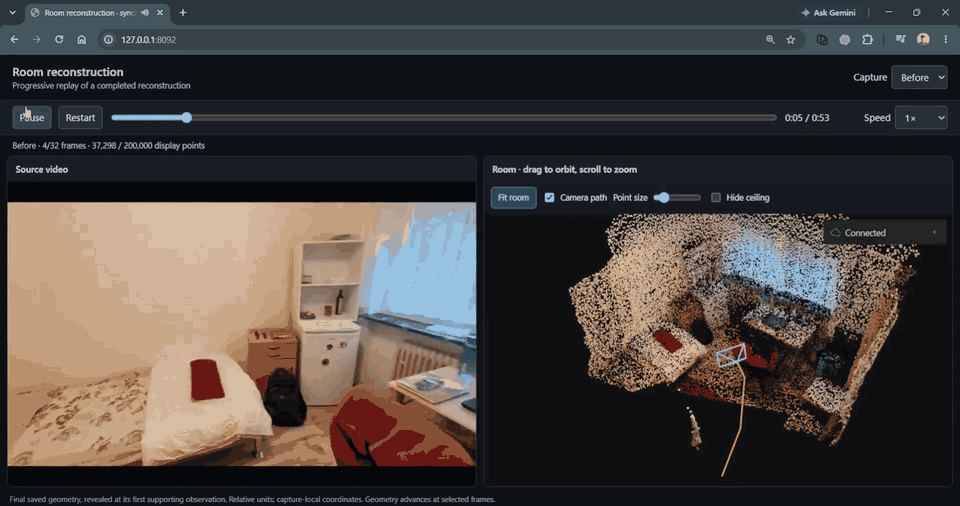
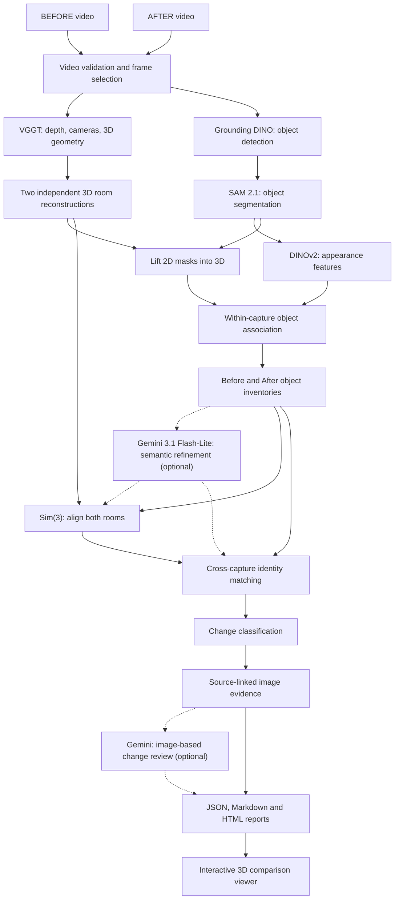

# Room Reconstruction

Compare two phone recordings to reconstruct a room, identify objects, and inspect
what changed with Before/After image evidence.

## Overview

**Input:** two overlapping RGB recordings of the same room. **Output:** colored
3D point clouds, object inventories, change proposals, and image reports.
GPU inference runs in Colab; comparison and inspection run locally.

## Results

### Changes visualizer
Compare linked Before/After scenes and inspect each object's change evidence.


### Object visualizer
Select an object to highlight its geometry and inspect its supporting photo.


### Reconstruction replay
Replay the recording as precomputed room geometry appears at its supporting timestamps.


## Architecture and design choices

The pipeline separates reconstruction, object identity, and change reasoning into
inspectable stages. Each change proposal retains the source observations needed
to understand how it was produced.




| Stage | Purpose | Tools |
|---|---|---|
| Frame selection | Select sharp, overlapping views while preserving source timestamps. | OpenCV |
| Reconstruction | Predict depth and cameras, then build colored point clouds. | VGGT-1B |
| Object inventory | Detect and segment objects, then associate them across views. | Grounding DINO, SAM 2.1, DINOv2 |
| Alignment | Estimate relative scale, rotation, and translation from fixed structures. | OpenCV |
| Change detection | Match identities globally and classify movement or presence changes. | SciPy |
| Optional visual review | Refine labels and review changes against source images. | Gemini 3.1 Flash-Lite |
| Inspection and export | Explore objects, compare scenes, replay recordings, and export reports. | Viser |


## Setup

### 1. Install local dependencies

Use Python 3.12. Run these PowerShell commands from the repository root:

```powershell
python -m venv .venv
$rdPython = (Resolve-Path '.venv/Scripts/python.exe').Path
& $rdPython -m pip install -r requirements.txt
```

`requirements.txt` covers local video processing, viewing, refinement, and CPU
comparison. Each Colab notebook installs its own GPU dependencies in its setup
cell. The two GPU environments remain isolated because their model stacks require
incompatible Hugging Face Hub versions.

### 2. Add the source recordings

Place the videos at `data/before.mp4` and `data/after.mp4`. Source data, generated
results under `outputs/`, and local notes under `docs/` are ignored by Git.

Already have matching reconstruction/object archives? Import them using the
commands in steps 3 and 4, then continue to step 5.

### 3. Reconstruct in Colab

Validate both videos, select source-linked frames, and build the input bundle:

```powershell
& $rdPython scripts/validate_inputs.py --before data/before.mp4 `
    --after data/after.mp4 --output outputs/input_validation
& $rdPython scripts/select_frames.py `
    --validation outputs/input_validation/input_manifest.json `
    --output outputs/frame_selection_connected
& $rdPython scripts/reconstruct.py prepare `
    --frames outputs/frame_selection_connected --output outputs/reconstruction
& $rdPython scripts/build_colab_bundle.py --run outputs/reconstruction `
    --output outputs/roomdelta3d_colab_submission.zip
```

1. Upload the ZIP to **My Drive / Room Reconstruction**. Change `DRIVE_FOLDER`
   in the notebook if you use another folder.
2. Open [the reconstruction notebook](notebooks/reconstruction_colab.ipynb) with
   a Colab GPU runtime and run setup.
3. Inspect the 4/8/16-frame pilots, then run the full Before and After captures.
4. Verify and export the result archive to Drive, then download it locally.

Use a fresh runtime for a changed bundle and pair the ZIP with the notebook
created by its builder. Choose new output paths for repeat runs.

Import and verify the downloaded result; substitute its actual filename:

```powershell
& $rdPython scripts/reconstruct.py import `
    --archive "$env:USERPROFILE/Downloads/roomdelta3d_reconstruction.zip" `
    --output outputs/reconstruction_colab
& $rdPython scripts/reconstruct.py verify --run outputs/reconstruction_colab
```

### 4. Build the object inventory

```powershell
& $rdPython scripts/build_objects_bundle.py `
    --reconstruction outputs/reconstruction_colab `
    --output outputs/roomdelta3d_objects_input.zip
```

Upload the bundle to the same Drive folder. Open
[the object notebook](notebooks/objects_colab.ipynb) with a GPU runtime, run setup,
inspect the pilot masks, then run full inference and export. This reuses saved
depth and cameras. Import the downloaded archive alongside its reconstruction:

```powershell
& $rdPython scripts/objects.py import `
    --archive "$env:USERPROFILE/Downloads/objects_result.zip" `
    --reconstruction outputs/reconstruction_colab --output outputs/objects_colab
& $rdPython scripts/objects.py verify `
    --reconstruction outputs/reconstruction_colab --objects outputs/objects_colab
```

### 5. Inspect objects or replay the recording

Object visualizer:

```powershell
& $rdPython scripts/reconstruct.py object-view `
    --run outputs/reconstruction_colab --objects outputs/objects_colab --port 8094
```

Open <http://127.0.0.1:8094>. Use the selection, **Focus object**, and **Isolate
object** controls. Keep ports 8094–8095 free.

Reconstruction replay:

```powershell
& $rdPython scripts/reconstruct.py sync-view `
    --run outputs/reconstruction_colab --objects outputs/objects_colab `
    --before-video data/before.mp4 --after-video data/after.mp4 --port 8092
```

Open <http://127.0.0.1:8092>. Playback supports seeking and independent room orbit.
**Fit room** restores the overview. Keep ports 8092–8093 free. The first launch
prepares cached browser-compatible video copies.

### 6. Compare changes and generate a report

This CPU workflow uses the raw inventory. Each run writes to new output folders:

```powershell
$rdComparison = 'outputs/comparison_' + (Get-Date -Format 'yyyyMMdd_HHmmss')
$rdReport = $rdComparison + '_report'

& $rdPython scripts/compare.py run `
    --reconstruction outputs/reconstruction_colab --objects outputs/objects_colab `
    --output $rdComparison
if ($LASTEXITCODE -ne 0) { throw 'Comparison failed.' }

& $rdPython scripts/compare.py report `
    --reconstruction outputs/reconstruction_colab --objects outputs/objects_colab `
    --comparison $rdComparison --output $rdReport `
    --viewer-url 'http://127.0.0.1:8098/'
if ($LASTEXITCODE -ne 0) { throw 'Report generation failed.' }

& $rdPython scripts/reconstruct.py object-view `
    --run outputs/reconstruction_colab --objects outputs/objects_colab `
    --comparison $rdComparison --report $rdReport --port 8098
```

Open <http://127.0.0.1:8098> for linked scenes or
<http://127.0.0.1:8098/report> for the report. Keep ports 8098–8100 free and stop
servers with **Ctrl+C**. Offline reports open through `report.html` with their
`assets/` folder beside it.

For an existing refined inventory, pass `--refinement outputs/objects_refined_discovery`
to comparison, reporting, and viewing. Use the same source artifacts throughout.

### 7. Optional Gemini change review

Set `GEMINI_API_KEY` or `GOOGLE_API_KEY` in your process environment. Copy
`configs/change_review.json` to `outputs/change_review.local.json` and configure
verified model availability, free-tier eligibility, and current project quotas.

Prepare evidence without provider calls:

```powershell
& $rdPython scripts/compare.py review `
    --reconstruction outputs/reconstruction_colab --objects outputs/objects_colab `
    --comparison $rdComparison --output outputs/change_review --prepare-only
```

Run the review with `--config outputs/change_review.local.json` in place of
`--prepare-only`. Verify with `scripts/compare.py verify-review` using the same
source/output arguments. Pass `--review outputs/change_review` when generating
reports and opening the viewer. Provider responses are cached; browsing saved
results makes no Gemini calls.
