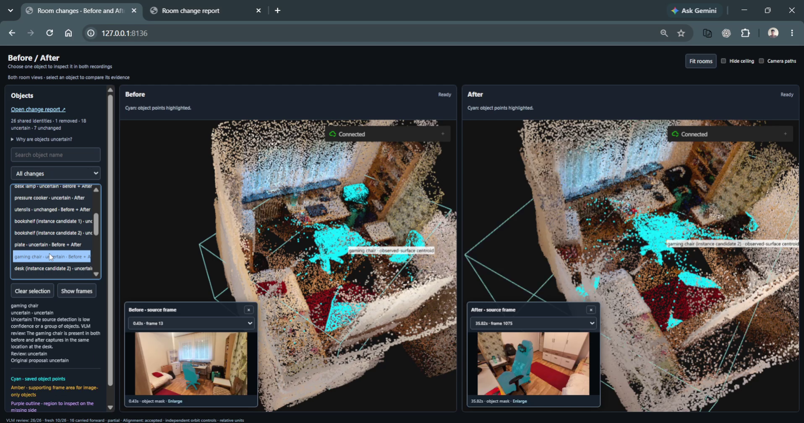
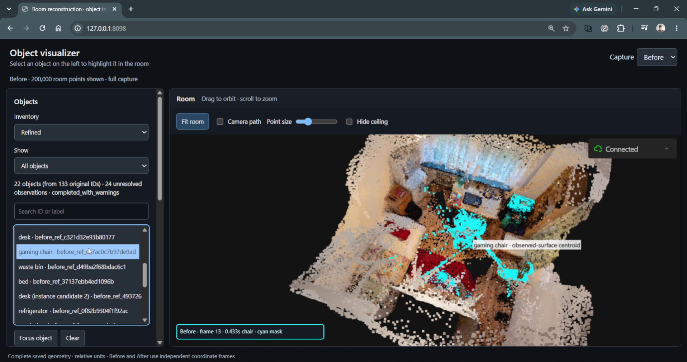
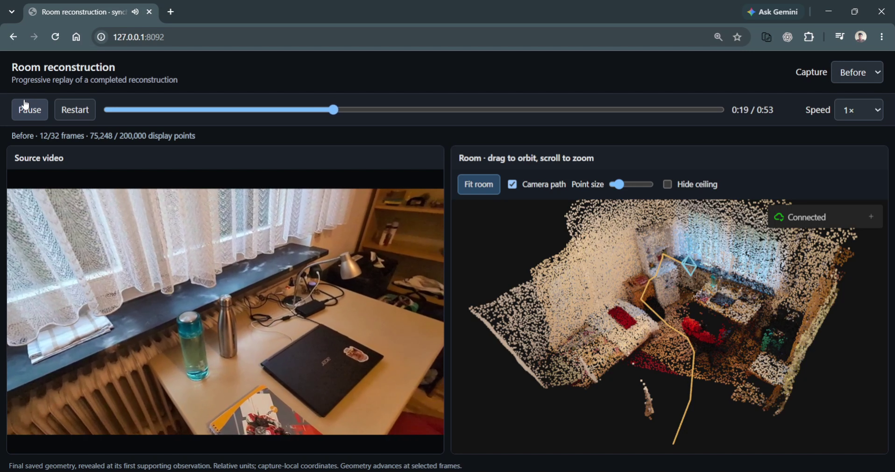

# Room Reconstruction v2 — What Changed in the Room?

Compare two phone recordings of the same room to locate and describe changes in
3D. The pipeline reconstructs each recording, aligns the two scenes, associates
objects across captures, and presents change proposals alongside their source
images.

Built for the [Humanoid Spatial AI and Navigation internship challenge](https://jobs.ashbyhq.com/humanoid/72741997-0fbc-413c-88a8-a273272641d1).

## Overview

**Input:** two short RGB videos of the same indoor space, recorded from different
viewpoints with overlapping coverage.

**Output:** colored 3D point clouds, camera poses, object inventories, a shared
coordinate frame when alignment succeeds, and labeled change proposals with
Before/After image evidence.

The system combines GPU inference in Colab with CPU-based comparison and local
browser viewers. Saved results can be inspected without rerunning models.

## Results

### Changes visualizer

Inspect Before and After in linked 3D scenes. Select a shared object identity to
highlight its instances, compare source images, and open the change report with
movement, presence, and uncertainty explanations.

[](assets/demos/changes-visualizer.mp4)

[Watch the changes visualizer demo](assets/demos/changes-visualizer.mp4).

### Object visualizer

Select, focus, or isolate an object in the reconstructed room and inspect its
supporting photo and segmentation mask. Image-only detections retain their image
evidence alongside objects with supporting 3D geometry.

[](assets/demos/object-visualizer.mp4)

[Watch the object visualizer demo](assets/demos/object-visualizer.mp4).

### Reconstruction replay

Watch the source recording beside the reconstructed room as precomputed geometry
appears at its earliest supporting timestamp. Play, pause, and seek through the
video while orbiting the room freely, or use **Fit room** to restore the overview.

[](assets/demos/reconstruction-replay.mp4)

[Watch the reconstruction replay demo](assets/demos/reconstruction-replay.mp4).

The [technical report](docs/image_evidence_and_change_reports_technical_report.md)
documents the saved baseline artifacts and their validation.

<details>
<summary>How to add demo videos to this README</summary>

The previews above link to MP4 recordings in `assets/demos/`, ready to include
when creating the GitHub repository. Each recording preserves the full demo and
its original audio, with H.264 video compressed below 10 MB.

For an inline GitHub player, edit this README on GitHub and drag the matching MP4
from `assets/demos/` into the editor under its demo heading. Wait for the upload
to finish, then replace the linked preview and watch link with the generated
attachment URL on its own line. Preview the README before saving. If the README
editor does not offer uploads, upload through a GitHub issue comment box and copy
the generated attachment URL into the README.

Use H.264-encoded MP4 for broad browser compatibility. GitHub currently allows
video attachments up to 10 MB on free plans or 100 MB on paid plans; see
[GitHub's attachment documentation](https://docs.github.com/en/get-started/writing-on-github/working-with-advanced-formatting/attaching-files).

Other options:

- **Hosted video:** upload to YouTube, Vimeo, or another video host and add a
  watch link. A screenshot linked to the video gives readers a clickable preview:

  ```markdown
  [](VIDEO_URL)
  ```

  Replace `VIDEO_URL` with the actual video address and add the preview image at
  the indicated path.
- **Animated GIF:** commit a short GIF under `assets/demos/` and embed it with
  ``. This works well for
  a silent preview; link the full recording beside it.
- **Downloadable recording:** attach the full MP4 to a GitHub Release and link
  to that asset from the demo section.

</details>

## Architecture and design choices

```text
Before / After videos
  -> validate and select source-linked frames
  -> reconstruct each capture independently
  -> detect, segment, and associate objects within each capture
  -> optionally refine the inventory with Gemini
  -> align After into the Before coordinate frame
  -> match identities globally and classify changes
  -> optionally review changes against source images with Gemini
  -> inspect 3D scenes, replay videos, and export evidence reports
```

### 1. Video validation and frame selection

Decode both recordings, preserve exact presentation timestamps, and select sharp
frames with connected visual overlap. Each selected image retains its source
video and frame identity.

**Tools:** PyAV for decoding and timestamps; OpenCV for sharpness, duplicate
checks, and ORB-based overlap tests.

### 2. Independent 3D reconstruction

Predict depth and camera poses for each capture, then lift valid pixels into
colored point clouds. Save pixel-to-point provenance so geometry can be traced
back to the original images. Before and After begin in separate coordinate frames.

**Tools:** VGGT-1B, PyTorch, and NumPy in an isolated Colab GPU environment.

### 3. Object inventories and optional refinement

Detect objects, segment their pixels, extract appearance descriptors, and link
observations across views within each capture. Optional Gemini refinement adds
derived labels and identity proposals while preserving the source inventory.

**Tools:** Grounding DINO, SAM 2.1, and DINOv2 through Hugging Face Transformers;
SciPy for spatial association; Gemini for optional image-based refinement.

### 4. Cross-capture alignment

Match fixed-structure image features and lift them through saved depth and camera
poses to estimate an After-to-Before similarity transform (scale, rotation, and
translation). Held-out residuals, distributed support, plane structure, and scale
stability determine whether the alignment is accepted.

**Tools:** OpenCV SIFT and mutual feature matching; NumPy RANSAC and SVD-based
similarity fitting.

### 5. Identity matching and change classification

Associate objects globally using semantic compatibility, appearance, shape, and
aligned geometry. One-to-one assignment includes unmatched alternatives so a
large move can preserve one identity. Classify moved, added, removed, unchanged,
and uncertain proposals using the saved relative geometry and evidence.

**Tools:** SciPy linear assignment and NumPy geometry in the comparison pipeline.

### 6. Optional visual change review

Review proposed identities using source photos, object crops, and room context.
Findings cite capture-specific frames and image regions; ambiguous or conflicting
evidence remains uncertain. Save responses and receipts for verification and resume.

**Tools:** Gemini with structured responses, indexed image evidence, and the
project's saved-review verification workflow.

### 7. Visualization and report export

Present linked Before/After scenes, object inspection, and synchronized video
replay. Export JSON, Markdown, and offline HTML reports with paired image evidence.
GPU inference runs separately from local inspection, which reuses saved artifacts.

**Tools:** Viser for interactive 3D; HTML/CSS/JavaScript for the viewers and
reports; PyAV for cached H.264/AAC playback copies.

## Setup

Use Python 3.12. Run the following PowerShell commands from the repository root:

```powershell
python -m venv .venv
$rdPython = (Resolve-Path '.venv/Scripts/python.exe').Path
& $rdPython -m pip install -r requirements.txt
```

This installs the dependencies for saved-result viewing, video processing, and
CPU comparison. GPU reconstruction and object inference use separate Colab
environments because their model stacks require different package versions:
`requirements-reconstruction.txt` pins `huggingface-hub==0.34.4`, while
`requirements-objects.txt` requires `huggingface-hub>=1.0,<2`. Keep those GPU
environments separate. All local dependencies are combined in `requirements.txt`.
Optional live Gemini refinement and review require provider
credentials; the viewers and geometric comparison do not.

## Inputs and artifacts

Place the two source recordings at `data/before.mp4` and `data/after.mp4`.
Videos and generated artifacts are excluded from the source checkout. They can
be generated using the [reconstruction workflow](#reconstruct-from-video), or
imported from matching result archives.

The commands below use this layout:

```text
data/
  before.mp4
  after.mp4
outputs/
  reconstruction_colab/        # completed reconstruction for both captures
  objects_colab/               # object inventories and segmentation evidence
  objects_refined_discovery/   # optional refined inventory
  comparison_changes_v1/      # alignment, shared identities, and change proposals
  change_report_highlighted/  # HTML, Markdown, JSON, and image assets
```

To import reconstruction and object results, substitute your downloaded archive
filenames below. Import destinations must not already exist.

```powershell
& $rdPython scripts/reconstruct.py import `
    --archive "$env:USERPROFILE/Downloads/roomdelta3d_v2_reconstruction.zip" `
    --output outputs/reconstruction_colab
& $rdPython scripts/objects.py import `
    --archive "$env:USERPROFILE/Downloads/objects_result.zip" `
    --reconstruction outputs/reconstruction_colab --output outputs/objects_colab

& $rdPython scripts/reconstruct.py verify --run outputs/reconstruction_colab
& $rdPython scripts/objects.py verify `
    --reconstruction outputs/reconstruction_colab --objects outputs/objects_colab
```

Keep reconstruction, inventory, and derived results from the same run together.
Verification checks source bindings and artifact hashes. Original videos are
needed for replay; object inspection and image reports use saved frame evidence.

## Explore the results

### Object inspection

```powershell
& $rdPython scripts/reconstruct.py object-view `
    --run outputs/reconstruction_colab --objects outputs/objects_colab --port 8094
```

Open <http://127.0.0.1:8094>. Select Before or After, then select an object to
highlight its geometry and open a supporting photo. Use **Focus object**,
**Isolate object**, and the centroid/bounds controls to inspect its location.
Image-only detections retain their image evidence and have no invented 3D
geometry. Ports 8094 and 8095 must be available.

### Synchronized reconstruction replay

```powershell
& $rdPython scripts/reconstruct.py sync-view `
    --run outputs/reconstruction_colab --objects outputs/objects_colab `
    --before-video data/before.mp4 --after-video data/after.mp4 --port 8092
```

Open <http://127.0.0.1:8092>. Play, pause, seek, or change playback speed while
orbiting the room independently. **Fit room** restores the overview; **Hide
ceiling** adjusts the displayed room context. Ports 8092 and 8093 must be free.
The first launch prepares cached browser-compatible video copies.

Replay reveals precomputed geometry according to its supporting timestamps.
Before and After have independent timelines; this is not online SLAM.

### Generate a comparison and change report

The following CPU-only workflow uses the raw object inventory. Each run writes
to a new output directory.

```powershell
$rdComparison = 'outputs/comparison_' + (Get-Date -Format 'yyyyMMdd_HHmmss')
$rdReport = $rdComparison + '_report'

& $rdPython scripts/compare.py run `
    --reconstruction outputs/reconstruction_colab --objects outputs/objects_colab `
    --output $rdComparison
if ($LASTEXITCODE -ne 0) { throw 'Comparison failed.' }

& $rdPython scripts/compare.py report `
    --reconstruction outputs/reconstruction_colab --objects outputs/objects_colab `
    --comparison $rdComparison --output $rdReport `
    --viewer-url 'http://127.0.0.1:8098/'
if ($LASTEXITCODE -ne 0) { throw 'Report generation failed.' }

& $rdPython scripts/reconstruct.py object-view `
    --run outputs/reconstruction_colab --objects outputs/objects_colab `
    --comparison $rdComparison --report $rdReport --port 8098
```

Open <http://127.0.0.1:8098> for the side-by-side scenes or
<http://127.0.0.1:8098/report> for the image report. Select a shared identity to
highlight its available instances and view the corresponding source images.
Ports 8098–8100 must be free. Stop the servers with **Ctrl+C**.

For a refined inventory, pass `--refinement outputs/objects_refined_discovery`
to all three commands. The same refinement must be used throughout comparison,
reporting, and viewing. Results from the raw inventory can differ from the
saved refined example.

To open the saved refined example:

```powershell
& $rdPython scripts/reconstruct.py object-view `
    --run outputs/reconstruction_colab --objects outputs/objects_colab `
    --refinement outputs/objects_refined_discovery `
    --comparison outputs/comparison_changes_v1 `
    --report outputs/change_report_highlighted --port 8098
```

An exported report can also be viewed offline: extract the complete report ZIP
and open `report.html`, keeping `assets/` beside it. Interactive 3D requires the
local viewer and corresponding geometry. See [report generation and export](docs/change_reports.md)
for verification, packaging, and evidence formats.

## Reconstruct from video

### 1. Prepare the recordings

Validate the videos, retain exact presentation timestamps, select sharp frames
with connected visual overlap, and prepare the reconstruction inputs:

```powershell
& $rdPython scripts/validate_inputs.py --before data/before.mp4 `
    --after data/after.mp4 --output outputs/input_validation
& $rdPython scripts/select_frames.py `
    --validation outputs/input_validation/input_manifest.json `
    --output outputs/frame_selection_connected
& $rdPython scripts/reconstruct.py prepare `
    --frames outputs/frame_selection_connected --output outputs/reconstruction
& $rdPython scripts/build_colab_bundle.py --run outputs/reconstruction `
    --output outputs/roomdelta3d_v2_colab_submission.zip
```

Use new output destinations for repeat experiments and stop if a stage fails.
Bundle generation updates the reconstruction notebook's expected source hashes
and bundle filename.

### 2. Run reconstruction in Colab

Open [the reconstruction notebook](notebooks/reconstruction_v2_colab.ipynb) in
browser Colab or the VS Code Colab extension with a GPU runtime.

1. Upload the generated ZIP to **My Drive / Room Reconstruction v2**.
2. Mount Drive and run setup. The notebook creates an isolated environment and
   verifies the pinned VGGT source and checkpoint.
3. Run the 4/8/16-frame pilots and inspect their depth previews and memory usage.
4. Run full Before and After inference separately, then verify the outputs.
5. Export the reconstruction archive and receipt to Drive and download them.
6. Import the archive locally using the commands above.

The notebook records model identities, package versions, hardware, timings, and
worker logs. Runtime files persist in Drive after export. Use the notebook
paired with the uploaded bundle; local edits do not update an existing Colab
extraction. Pilot success does not guarantee that the full capture fits in GPU
memory.

### 3. Build the object inventories

Prepare an object-inference bundle from the completed reconstruction:

```powershell
& $rdPython scripts/build_objects_bundle.py `
    --reconstruction outputs/reconstruction_colab `
    --output outputs/roomdelta3d_v2_objects_input.zip
```

Upload it to the same Drive folder and open
[the object notebook](notebooks/objects_v2_colab.ipynb) with a GPU runtime.
Run setup, inspect the three-frame-per-capture pilot masks, then run full
inference and export the object archive. Import it alongside the matching
reconstruction. Object inference reuses the saved depth and cameras; it does
not rerun VGGT.

Grounding DINO supplies detections, SAM 2.1 supplies masks, and DINOv2 supplies
appearance descriptors. Multi-view association links observations to per-capture
objects and their supporting cloud points.

### 4. Compare and inspect

Run the [comparison and report commands](#generate-a-comparison-and-change-report)
above. Optional Gemini refinement adds derived labels and identity proposals
without replacing the original masks or geometry. Optional image-based change
review is documented in [Gemini change review](#gemini-change-review).

## Gemini change review

The reviewer covers every shared identity, including unchanged and uncertain proposals. Update means movement only. No reconstruction, segmentation or detection is rerun. Raw inventories and comparisons remain unchanged.

### Prepare without credentials or network calls

Run from the repository root after completing [Setup](#setup):

```powershell
& $rdPython scripts/compare.py review --reconstruction outputs/reconstruction_colab --objects outputs/objects_colab --refinement outputs/objects_refined_discovery --comparison outputs/comparison_changes_v1 --output outputs/change_review_v1 --prepare-only
```

Preparation saves a verified evidence report, indexed room-wide contact sheets, and a partial `review.json`. Unreviewed objects are explicitly uncertain with `review_status: not_reviewed`; original classifications remain in `original_proposals`. Preparation does not claim that Gemini reviewed the pictures.

### Configure verified free-tier quotas

Copy `configs/change_review.json` to an ignored local file under `outputs/`. Use a supported review model (Gemini 3.1 Flash Lite or Gemini 3.5 Flash Lite) and the same project scope as the refinement workflow. In Google AI Studio, verify that this model is available on the project's free tier and record:

- `quota_verified: true` and `free_tier_verified: true`;
- `quota_verified_at`: Unix timestamp when you checked the allowance;
- `requests_per_minute`, `input_tokens_per_minute`, `requests_per_day`;
- `remaining_requests`: known remaining daily requests at that timestamp.

These are operator-supplied observations, not values inferred from the old refinement config. Refresh the snapshot after Pacific midnight. Do not put API keys in config files. Set `GEMINI_API_KEY` or `GOOGLE_API_KEY` in the process environment.

```powershell
& $rdPython scripts/compare.py review --reconstruction outputs/reconstruction_colab --objects outputs/objects_colab --refinement outputs/objects_refined_discovery --comparison outputs/comparison_changes_v1 --output outputs/change_review_v1 --config outputs/change_review.local.json
```

The review stage has no fixed two-generation or ten-generation/day ceiling. It retains at least 65 seconds between generations, uses 90 percent of verified minute limits, counts preflight and failed requests, and shares the existing project cache/quota ledger under this checkout's `outputs/refinement_cache`. Existing refinement retains its own two-generation budget. Other applications using the same project can consume quota outside this ledger; a provider quota response stops the run.

Use `--batch-size-limit 1` to resume with smaller requests after inspected provider capacity failures, without changing source bindings or replaying completed batches.

To deliberately continue unfinished work with another supported model, pass `--execution-config outputs/alternate_model.local.json` containing that model's verified free-tier quotas. Keep the original `--config` and project scope. Each new batch saves its actual provider configuration; verification checks its model-specific receipt. Completed answers retain their original model and are reused. The shared project ledger is preserved; there is no automatic model fallback.

A failed or unknown provider outcome is never automatically retried, including in a different output directory sharing the cache. Inspect receipts before explicitly adding `--retry-failed`; prior failed/unknown receipts are retained under `requests/attempts/`. Update an expired/exhausted quota snapshot before resuming. Completed batches are reused. Unresolved identities with a third selected view receive at most one targeted follow-up, grouped into batches of up to four identities to share room context. Large multi-identity requests split deterministically; an oversized single-identity request stops without discarding evidence.

The optional `--evidence-report outputs/change_report_v2` reuses a verified original report without rerunning evidence selection. Historical HTML is hash checked, while canonical JSON and image provenance remain authoritative; a renderer update does not invalidate review evidence. A new review output is required when the review prompt changes.

The optional `--credential-source ../"Room Reconstruction"/scripts/test_gemini_vlm.py` reads an already configured local key as data, without executing or copying its script. Environment variables take precedence. No credential value is written to review artifacts.

AI Studio's 28-day **peak** usage is not today's usage. When an exact current-day count is unavailable, reserve at least the larger of the reported daily peak and the known local API request count; this is a conservative allowance, not a live provider quota query. Provider quota errors still stop the run.

### Verify, display and export

```powershell
& $rdPython scripts/compare.py verify-review --reconstruction outputs/reconstruction_colab --objects outputs/objects_colab --refinement outputs/objects_refined_discovery --comparison outputs/comparison_changes_v1 --output outputs/change_review_v1
& $rdPython scripts/compare.py report --reconstruction outputs/reconstruction_colab --objects outputs/objects_colab --refinement outputs/objects_refined_discovery --comparison outputs/comparison_changes_v1 --review outputs/change_review_v1 --output outputs/change_report_reviewed_v1 --viewer-url http://127.0.0.1:8116/
& $rdPython scripts/reconstruct.py object-view --run outputs/reconstruction_colab --objects outputs/objects_colab --refinement outputs/objects_refined_discovery --comparison outputs/comparison_changes_v1 --review outputs/change_review_v1 --report outputs/change_report_reviewed_v1 --port 8116
```

Generate the report before starting the viewer, and pass `--report` to enable its Open change report link. The viewer does not attach a report that was generated later.

Use the same `--review` for report verification/packing, or the saved review source location. A reviewed report automatically selects its corresponding review when opened in the viewer. A raw report cannot be combined with a reviewed display. Browsing never calls Gemini. Older comparison and report artifacts still open without a review.

### Decision and evidence rules

Gemini gets source pictures, crops, proposed regions and room-wide context, but no original classifications or distances. Findings must cite supplied capture-specific frames and normalized full-frame boxes. Appearance and fixed landmarks support identity across the whole room. Invalid references, conflicts, occlusion, unseen regions and ambiguous assignments stay uncertain. New requests enforce 0–1000 box bounds in the response schema, and each batch records its actual schema so earlier receipts remain verifiable. A supporting shelf/container cannot be silently reassigned as the item it supports. If a VLM presence claim abandons an already inventoried matched counterpart, that counterpart must be accounted for before publishing added/removed. Added/removed results require a targeted close-up confirmation of the source object and visible opposing region, and remain estimated. A coarse room view alone cannot confirm disappearance or replacement.

Global reconciliation preserves each source object exactly once, including unmatched competitors. A corrected match merges added/removed proposals into one identity. Newly located counterparts remain uncertain until a targeted follow-up inspects their proposed close-up and full-frame context. Confirmation must refer to the candidate region; a different unconfirmed box remains uncertain. This also qualifies as useful additional evidence when no third inventory view exists. Newly located counterparts are derived image-only observations with null centroids; they never inherit a parent object's geometry. Existing arithmetic means and movement threshold remain authoritative for numerical comparisons. Visual disagreement downgrades the result to uncertain rather than inventing a displacement.

`review.json` records original proposals, reviewed identities/events, capture IDs, evidence findings, derived observations, movement basis, uncertainty, coverage and API receipts. Verification replays saved findings against original geometry and rejects changed results even when artifact hashes have been updated. Review/report outputs are separate artifacts; regenerating a review makes reports bound to an older review stale.

Saved structured responses can be imported using `--answers path/to/answers.json`, without credentials or provider calls. The file uses the response schema returned by `reconstruction_v2.review_evidence.schema()` and must reference shared IDs in `evidence_index.json`. Offline imports are explicitly marked `origin: offline` in the saved steps. A completed workflow means every source identity received a review attempt; uncertain conclusions are retained, and this is not an independently measured accuracy score.

A source-picture audit can reject a model claim using an optional `local_visual_validation.json` inside the review directory. Its `local-visual-validation-v1` rejections cite a known shared identity, frame ID, matching image hash, and reason. Replay only downgrades affected events to uncertain; it cannot confirm changes or invent locations. Model answers and receipts remain intact. Re-publishing with `--prepare-only` preserves a previous provider stop reason.

Legacy coordinate recovery is opt-in per saved batch using `recover_supplied_pixel_boxes: [shared_id, ...]` in a separate checked review copy. All boxes in each selected response must fit the original frame and match pixel regions supplied for that identity/frame within two pixels of rounding tolerance; at least one must exceed normalized bounds. Reversed, unsupported or ambiguous regions remain invalid. The raw model response and its receipt are unchanged; converted coordinates are recorded in the reviewed findings. Older review artifacts keep their original interpretation.

Use `--prompt-profile visual-grounding-v2` in a fresh review directory for the revised visual-grounding prompt. This adds a labelled inventory crop gallery, supplies normalized boxes exclusively, and uses one primary view per evidence role initially; additional views remain available for a targeted follow-up. The profile and system prompt hash are bound to the review, receipts, and replay. Legacy artifacts retain their original prompt interpretation. Gemini 3.8 Flash and 3.6 Flash are also accepted only with an explicitly configured free-tier quota profile.
