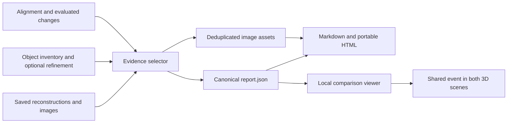

# RoomDelta3D v2: image evidence and structured change reporting

**Date:** 16 October 2026  
**Implementation baseline:** `b526bb6` — `Add change reports with paired highlighted image evidence`  
**Scope:** Steps 8–9, including paired Before/After galleries and restored default highlights. Separate, uncommitted VLM-review extensions are outside this report.

## 1. Purpose and outcome

The reporting stage connects each saved room-comparison event to inspectable image evidence and its shared 3D identity. It exports one canonical JSON report, a Markdown summary, and an offline HTML report with deduplicated image assets. The existing comparison viewer can serve the report and open an event in both 3D scenes.

Reporting reuses completed reconstructions, object inventories, optional refinements, alignment, and evaluated changes. It runs locally on CPU, uses saved images only, and makes no new reconstruction, object-model, or provider calls. It preserves upstream classifications and trust.

The implementation has passed software validation. Visual evidence acceptance remains partial: the saved review identifies incorrect upstream labels, ambiguous identities, broad context views, and an estimated removal contradicted by an opposing image. Successful export does not validate physical room changes.

## 2. Pipeline context and architecture

The upstream workflow reconstructs Before and After independently, associates saved object observations with geometry, optionally refines the inventory, aligns the captures, matches identities across the room, and evaluates changes. Reporting starts after that evaluation. Identity-only legacy comparisons without `changes.json` are insufficient.



| Component | Responsibility |
|---|---|
| [report_evidence.py](../reconstruction_v2/report_evidence.py) | Candidate construction, ranking, viewpoint selection, image export, visibility limitations |
| [region_reference.py](../reconstruction_v2/region_reference.py) | Reusable projection into saved camera views and original image pixels |
| [change_report.py](../reconstruction_v2/change_report.py) | Canonical event records, measurements, coverage, integrity verification, atomic export and ZIP packaging |
| [report_render.py](../reconstruction_v2/report_render.py) | Markdown and HTML generated from the canonical JSON; paired capture galleries |
| [report.html](../reconstruction_v2/report.html) | Offline presentation, search, filters and evidence controls |
| [comparison_viewer.py](../reconstruction_v2/comparison_viewer.py) | Report routes, allowlisted assets and selection/focus actions |
| [compare.py](../scripts/compare.py) | Generation, verification, packaging and presentation refresh commands |
| [test_change_report.py](../tests/test_change_report.py) | Evidence, geometry, integrity, rendering and HTTP regression checks |

## 3. Evidence roles and selection

Each event has four evidence roles. Separating object observations from opposing location views prevents a projected region from being interpreted as proof of object visibility or absence.

| Role | Capture searched | Intended evidence |
|---|---|---|
| `object_before` | Before | Saved observation or context for the Before object |
| `object_after` | After | Saved observation or context for the After object |
| `old_location_after` | After | The Before object's location viewed in After |
| `new_location_before` | Before | The After object's location viewed in Before |

An addition or removal can lack an object identity in one capture. The opposite capture is then searched for a view of the corresponding location when usable alignment and geometry permit it. An unavailable opposing view stays explicitly unavailable.

### Candidate ranking

Candidates record region coverage, border clearance, sharpness, geometry support and suspected occlusion. Sharpness uses the variance of a discrete Laplacian on a grayscale region, downsampled to at most 512 pixels per dimension.

The current heuristic ranking score is:

```text
score = 0.35 × coverage
      + 0.20 × border_clearance
      + 0.30 × sharpness_normalized
      + 0.15 × geometry_support_normalized
      − 0.60 × occlusion_penalty
```

Sorting first prefers candidates with a locatable region, and then favors non-context candidates over context-only observations before comparing the score. Frame ID and source observation/context ID resolve ties deterministically. This score ranks images; it is not a calibrated confidence probability.

The selector exports one primary view and up to two alternatives per role. Alternatives prefer different camera positions or directions, and a frame is not repeated within a role. Ranking components and selection reasons remain in the exported records.

An inherited shelf or container segmentation for an image-only refined item is treated as context. It is not presented as a pixel mask of the named item.

### Visibility and missing views

The depth heuristic compares projected region geometry with valid saved depth using the existing association tolerance. At least eight distinct model pixels are needed; a majority of closer depth samples flags `suspected_occlusion`. Matching depth does not establish verified visibility, and the heuristic is not independently calibrated.

| Limitation | Meaning |
|---|---|
| `no_supporting_view` | No suitable saved evidence is available for the role |
| `outside_frame` | The projected region is outside the available frame coverage |
| `suspected_occlusion` | Saved depth suggests closer surfaces may obscure the region |
| `visibility_unknown` | Visibility or absence has not been established |
| `alignment_unusable` | Cross-capture projection cannot use an accepted alignment |
| `region_unavailable` | A trustworthy image region could not be located |

If a useful associated full-frame reference exists but its region cannot be located, the full frame can be retained while highlight and crop remain null. The system does not substitute an unrelated photograph.

## 4. Coordinate and measurement semantics

The shared comparison frame is `before_world`. Accepted alignment supplies an After-to-Before similarity transform:

```text
p_before_world = scale × rotation × p_after_world + translation
```

The transform is applied once to After geometry used for comparison. Projection then uses cameras expressed in the corresponding coordinate system, camera intrinsics, and the saved model-to-original image transform. Cross-capture location evidence is disabled when alignment is unusable. Projection is available without starting the viewer.

For an event measured from usable object geometry, the report retains source centroids and comparable centroids in `before_world`:

```text
displacement_vector = centroid_after_in_before_world − centroid_before
displacement = norm(displacement_vector)
```

Unavailable centroids or displacement stay null. Existing whole-frame-cloud means and distances are stored separately under `frame_cloud_estimate`; they are not relabeled as object centroids or physical displacement. Changes in camera framing can affect these contextual estimates.

The movement threshold and measurement basis are copied from the evaluated comparison. Reporting does not rematch objects, change the threshold, or reclassify events. Presence-only additions/removals remain estimates because the existing rule does not verify an empty opposing location. “Reliable” retains its MVP meaning of usable object geometry. Measurements remain relative, and `real_scene_accuracy` is `not_independently_validated`.

## 5. Image exports and provenance

For every selected view, the exporter provides:

1. The original full-resolution source frame, preserving its saved PNG bytes.
2. A full-resolution highlight: cyan object-mask tint when supported, otherwise a labeled context or projected outline.
3. An untinted close-up with 10% padding per axis, clipped to the source image bounds.

Evidence records retain capture, stable frame ID, observation/context ID, decoded frame index, original timestamp, PTS and time base, elapsed timestamp, source hashes, region coordinates and crop coordinates in original pixels. Assets are deduplicated using source/content identity and rendering settings.

Each event begins with **Images used for comparison**, showing Before and After together. The presentation prefers the corresponding `object_*` role; if that role has no view, it reuses the capture's opposing location-reference role and labels it as a reference. An object role can itself contain context-only evidence, so a populated panel does not guarantee an isolated object mask.

Saved highlights are the default display. Full frame, close-up, alternative frames and image enlargement remain available. Detailed evidence exposes all four roles and their limitations. If no highlight exists, the gallery falls back to that same view's original frame.

### Pan example

For event `shared_cd9ebaa0daeb18f3`, the restored primary views are:

| Capture | Decoded frame | Elapsed timestamp | Evidence |
|---|---:|---:|---|
| Before | 1288 | 42.924856 s | Saved object-mask highlight |
| After | 276 | 9.186044 s | Saved shelf-context outline |

The full stable frame IDs end in `_00001288` and `_00000276`; the canonical JSON retains their complete capture/source-hash identities. The After outline is contextual. Restoring the highlight does not make it a pan segmentation or validate the preserved `unchanged` / `estimated` result.

## 6. Canonical report and integrity

`change-report-v1` is the canonical JSON contract. Markdown and HTML are rendered from this record.

| Record area | Contents |
|---|---|
| Scene | Alignment status and diagnostics, relative units, movement threshold, event counts and saved-input coverage |
| Events | `event_id == shared_id`, capture-specific object IDs and labels, classification, trust, explanation, uncertainty and identity alternatives |
| Measurements | Source/common-frame centroids, displacement vector and magnitude, basis and separate frame-cloud estimates |
| Confidence | Existing trust and available source assessments with reasons; no invented probability |
| Evidence | Four roles, selected views, rankings, provenance, image paths and explicit limitations |
| Visualization | Shared identity and viewer selection URL |

The exported directory contains:

```text
report/
  report.json
  summary.md
  report.html
  manifest.json
  assets/
```

The manifest binds source manifests, comparison changes and identities, configuration, generating code and exported artifact hashes. Generation uses a writer lock and staging directory, verifies the result, and publishes atomically to a new destination. Existing results are preserved.

Verification checks source bindings, artifact hashes, safe paths, event/image references, regions, measurements and classification consistency. Stale or corrupt inputs must be resolved before publication. Packaging verifies and writes a ZIP with the report and relative assets.

`refresh-report` updates presentation in a new directory while preserving canonical events and saved evidence. This supports restoring paired images or highlight defaults without rerunning image selection or changing classifications.

## 7. Web and offline presentation

The comparison viewer accepts optional `--report` and serves `/report`, `/report.json`, `/summary.md` and manifest-listed assets. The report supports label search, event-type and trust filters, alternative images, and full-frame/highlight/crop controls.

An event link uses `/#event=<shared_id>`. After initialization, the viewer selects the corresponding event and requests focus for usable selected geometry in both scenes. The viewer remains usable without a report.

Portable HTML uses relative assets and no external scripts or services. It can be opened directly after extracting the complete ZIP. Interactive 3D requires the local viewer and original geometry artifacts; the portable report does not embed the two room reconstructions. Its viewer URL is configurable, and the local served report uses the current viewer origin.

## 8. Saved-run results

The following values were read from `outputs/change_report_highlighted/report.json` and its manifest on 16 October 2026. They describe one saved report, not physical ground truth.

| Metric | Result |
|---|---:|
| Events | 26 |
| Available saved frames, Before / After | 32 / 30 |
| Unique selected frames, Before / After | 25 / 25 |
| Paired capture panels with a saved view | 52 / 52 |
| Primary paired panels with highlights | 52 / 52 |
| Panels using opposing-location fallback | 7 |
| Deduplicated image assets | 470 |
| Manifest-listed artifacts, excluding the manifest itself | 473 |

| Preserved event type | Count |
|---|---:|
| Added | 1 |
| Removed | 2 |
| Moved | 0 |
| Unchanged | 10 |
| Uncertain | 13 |

Trust comprises 12 estimated events, 13 uncertain events and one reliable event. The reliable event is classified unchanged.

| Evidence role | Events with views | Events without views | Events with unknown visibility |
|---|---:|---:|---:|
| `object_before` | 22 | 4 | 22 |
| `object_after` | 23 | 3 | 23 |
| `old_location_after` | 22 | 4 | 22 |
| `new_location_before` | 23 | 3 | 23 |

Four old-location bundles also flag suspected occlusion. Limitations can overlap. All 52 paired panels can be populated while individual evidence roles remain missing because the paired presentation uses explicitly labeled fallbacks. These counts describe saved-input coverage; they do not measure how much of the physical room was surveyed.

The saved alignment is accepted under the existing engineering checks: 4,182 correspondences, held-out inlier fraction 0.8031, median held-out residual 0.012201 relative units, scale 1.013206 and subsample scale variation 0.004937. The movement threshold is 0.443550 relative units. These diagnostics are not independent depth calibration or metric-accuracy measurements.

## 9. Validation and evidence acceptance

### Software validation

The report-only candidate for commit `b526bb6` was isolated from concurrent VLM-review changes and validated separately. The full suite recorded **146 passed, 4 skipped and 4 passing subtests** in 572.15 seconds. Ruff passed on the nine changed Python files, and the staged diff passed whitespace and credential-pattern checks.

Regression coverage includes deterministic ranking, sharp/blurred images, clipping, masks versus context, missing opposing views, suspected occlusion, invalid crops, rejected alignment, coordinate transforms, sparse geometry, separate frame-cloud estimates, stable IDs/counts, stale/corrupt artifacts, escaped labels, safe asset paths and viewer HTTP behavior.

Existing local validation receipts record offline and served browser checks at desktop and mobile viewport sizes. The paired-report receipt records 26 event rows, 52 loaded images and seven reference panels without reported browser errors. Another receipt records an event link selecting the expected shared identity. These are recorded prior browser checks; this documentation task did not repeat them.

Local validation records are retained under `outputs/`, including `commit_validation/report_scope_tests.log`, `change_report_implementation_validation.json` and `paired_report_validation.json`. They are generated artifacts and are not part of the source commit.

### Visual acceptance

The saved agent review inspected all 26 primary event rows in contact sheets and recorded:

| Review finding | Events |
|---|---:|
| Usable object evidence | 10 |
| Upstream label or identity problem | 5 |
| Limited object evidence | 8 |
| Contradicted presence classification | 1 |
| Primary context does not show the named object | 2 |

The estimated bedside-cabinet removal is contradicted by the opposing image. Some bottle views do not clearly show the named object; the pan's After view remains broad shelf context. These findings are recorded in `outputs/change_report_v2_visual_review.md` and do not modify source classifications.

Artifact generation and verification succeeded. Visual acceptance is partial, and the review is not independent real-scene ground truth. Better labels, object observations and identity assignments are upstream work; evidence presentation alone does not resolve them.

## 10. Reproduction and operation

Run from the v2 repository in PowerShell. The following uses the existing saved source directories and creates a new report destination. The report viewer uses the chosen base port and the next two ports.

```powershell
Set-Location 'C:\Users\prati\OneDrive\Desktop\Room Reconstruction v2'
$rdPython = 'C:\Users\prati\OneDrive\Desktop\Room Reconstruction\.venv\Scripts\python.exe'
$rdReconstruction = 'outputs/reconstruction_colab'
$rdObjects = 'outputs/objects_colab'
$rdRefinement = 'outputs/objects_refined_discovery'
$rdComparison = 'outputs/comparison_changes_v1'
$rdReport = 'outputs/change_report_' + (Get-Date -Format 'yyyyMMdd_HHmmss_fff')
$rdArchive = $rdReport + '.zip'

& $rdPython scripts/compare.py report `
    --reconstruction $rdReconstruction --objects $rdObjects `
    --refinement $rdRefinement --comparison $rdComparison `
    --output $rdReport --viewer-url 'http://127.0.0.1:8130/'
if ($LASTEXITCODE -ne 0) { throw 'Report generation failed.' }

& $rdPython scripts/compare.py verify-report `
    --reconstruction $rdReconstruction --objects $rdObjects `
    --refinement $rdRefinement --comparison $rdComparison --output $rdReport
if ($LASTEXITCODE -ne 0) { throw 'Report verification failed.' }

& $rdPython scripts/compare.py pack-report `
    --reconstruction $rdReconstruction --objects $rdObjects `
    --refinement $rdRefinement --comparison $rdComparison `
    --output $rdReport --archive $rdArchive
if ($LASTEXITCODE -ne 0) { throw 'Report packaging failed.' }

& $rdPython scripts/reconstruct.py object-view `
    --run $rdReconstruction --objects $rdObjects --refinement $rdRefinement `
    --comparison $rdComparison --report $rdReport --port 8130
```

Open `http://127.0.0.1:8130/report`. Use another free three-port range if needed and change the viewer URL consistently. To share offline, extract the ZIP and open `report.html` with `assets/` beside it. See [the operational guide](change_reports.md) for configuration and refresh commands.

## LinkedIn description

I've extended my RoomDelta3D project with an evidence-linked reporting layer for comparing room reconstructions. Each event connects paired Before/After images, saved highlights and close-ups to its identity in the 3D viewer. Built with Python, NumPy, Pillow and Viser, it exports JSON, Markdown and offline HTML reports with frame provenance and explicit uncertainty. Reporting runs locally on CPU using saved artifacts. Measurements remain relative, with physical accuracy still to be independently validated.
